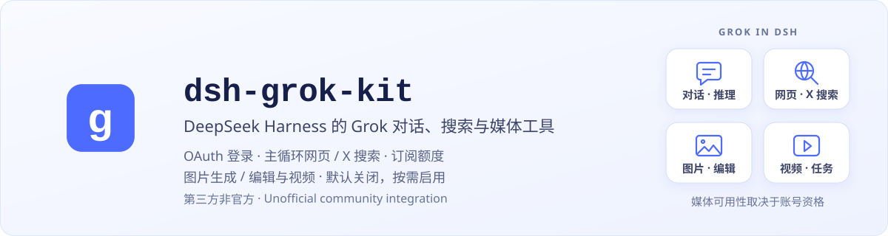
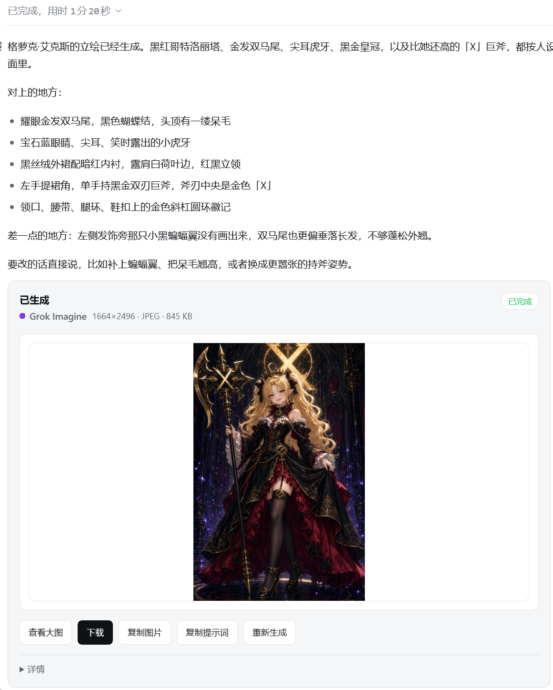

# dsh-grok-kit

[中文](README.md) · **English**

<p align="center">
  
</p>

<p align="center">
  <a href="https://github.com/MaRi23333/dsh-grok-kit/actions/workflows/ci.yml"></a>
  <a href="https://www.npmjs.com/package/dsh-grok-kit"></a>
  <a href="LICENSE"></a>
  
  
</p>

> Use Grok in DeepSeek Harness through OAuth: fused web/X search in the main model turn, reasoning continuity across turns, image generation and editing, video generation (experimental), and an xAI-only proxy.

## More than OAuth sign-in

`dsh-grok-kit` adds a separate `xai-oauth` route to [DeepSeek Harness](https://github.com/deepseek-ai/deepseek-harness). It does not require `XAI_API_KEY` or patch dsh source code. The point is not only to sign in, but to bring server-side search and the fields required for continuous reasoning into the main chat path.

- **Search in the main loop:** web and X lookup occurs inside Grok's current Think turn, so reasoning can use newly found material immediately
- **Continuous multi-turn reasoning:** high effort is the default, with `reasoning.encrypted_content` preserved for the next turn
- **Sign-in stays in sync with Grok CLI:** the plugin shares and writes back `~/.grok/auth.json` instead of copying once and rotating refresh tokens separately
- **Image generation and editing (experimental):** `grok_imagine` for text-to-image and `grok_imagine_edit` for image-to-image (reusing the main OAuth session), off by default and enabled after risk confirmation in Settings. Non-chat models stay out of the conversation picker
- **Session image cards:** generated and edited images are stored in the DSH attachment library and rendered in session cards showing the prompt, inputs, and result, with download and re-generate/re-edit actions
- **Video generation (experimental):** image-to-video with durable tasks, resume, and account-scoped downloads; off by default, enabled after risk confirmation and a DSH restart

Supporting behavior includes an xAI-only proxy, forced refresh and one retry on chat 401, atomic credential writes, a capability status page, and diagnostic redaction.

### The X Subscription and legacy plans

**Sign in with Grok / X Subscription** uses the same official Grok OAuth flow for the X Subscription and legacy SuperGrok / X Premium plans. Signed-in users can reauthorize to switch accounts without first deleting shared credentials. The account page also links to the [official subscription dashboard](<https://grok.com/dashboard>).

Quota comes from the official billing/settings responses: percentage, period, plan and prepaid balance. When the billing response omits the usage percentage, subscription details remain visible while used/remaining usage stays unknown—not fabricated 0% or unlimited usage. Unified billing is identified by the reported flag, not guessed from the plan name. Only the signed-in identity is shown; workspaces and seats are not aggregated. The plugin does not provide Cursor sign-in or integrations for other models or external agents.

**0.2.7** hardens where OAuth sign-in credentials can be sent: request destinations are checked centrally, and credentialed requests reject redirects. Normal endpoints and proxy settings are unchanged; quota loading keeps the previous release's failure fallback. See [CHANGELOG.md](CHANGELOG.md).

## Search in the main model turn

The same model id does not guarantee the same experience across integrations. [xAI documents that `grok-4.6` is available in both Grok Build and the public API](https://docs.x.ai/build/overview); the important search difference is whether server-side tools share the main conversation request.

**Separate search** sends another model request to retrieve or summarize material before returning it to the main conversation. That path remains useful when explicit filters are needed, but adds another model round, and its search summary is not produced inside the current reply's Think turn.

**Main-turn search** follows [xAI's server-side Responses search pattern](https://docs.x.ai/developers/tools/web-search), placing `{type:web_search}` and `{type:x_search}` directly on the main Grok request. Lookup occurs inside Think, so the model can use newly found web and X material during the same reasoning turn. This path is off by default (since v0.1.8); enable it from Settings or config.

To let both search systems coexist, DSH's native `web_search` remains in the host tool list but is removed from an xAI payload with fused search enabled, preventing a server-tool name collision. Other model routes can continue using the host search tool normally.

> When main-turn search is on, the plugin strips xAI reject stubs such as `x_keyword_search` so DSH does not start another step and reprint the writeup. If those names still appear, treat them as a diagnostic path, not normal UI.

For domain, account, or date filters, use the standalone `grok_web_search` / `x_search` tools — the default path while `backendSearch` is off; enabling `backendSearch` turns this standalone path into the optional mode.

`statefulResponses` is off by default. When enabled, the plugin uses `store: true` and `previous_response_id` to continue the conversation, appending only new user messages. It does not continue a turn that used client tools such as bash, to avoid repeating an existing search answer. Continuing a conversation does not guarantee that all search material from the previous turn is cached.

## Interface and behavior

### Image generation and session cards

<p align="center">
  
</p>
<p align="center"><em>A real text-to-image result, displayed directly in a session card. View it at full size, download it, copy the image or prompt, or generate it again.</em></p>

Video results use the same card layout. Image generation, editing, and video are experimental and off by default; enable them in Settings after confirming the risks. Availability depends on account eligibility and service-side restrictions.

<br><br>

### Account, models, and proxy

<p align="center">
  
</p>
<p align="center"><em>Settings reuses the Grok CLI login, exposes account-visible models, and optionally configures a proxy for xAI only. <code>127.0.0.1</code> in the example is a loopback proxy address.</em></p>

<br><br>

### Web search inside the main loop

<p align="center">
  
</p>
<p align="center"><em>No nested search-tool card is opened: web lookup occurs inside the same Think turn, and the material is used immediately by the current reply. The news content is illustrative UI data, not a factual reference.</em></p>

## Install

Desktop and Web have separate plugin installations and activation states. Choose the client you use; installing into the Web profile does not install the plugin into Desktop.

### Desktop app

1. Open the desktop app and select **Plugins → Add plugin** in the sidebar.
2. Enter `dsh-grok-kit@latest` and install it, or use `dsh-grok-kit@0.2.7` to pin this release.
3. Click **Enable now** when installation finishes. If prompted to restart, fully quit through the application menu or tray **Quit** action, then reopen the app. Closing the window may only hide it.
4. Check that **Settings → xAI Grok** is available, then sign in with an eligible account.

This route does not require `dsh` on PATH. For terminal installation, follow the [desktop-bundled CLI steps](INSTALL.md#desktop-cli). An npm-installed or `npx` CLI cannot manage the `desktop` profile.

### Web / CLI

Use the same DSH CLI that starts your Web instance to install into its `web` profile:

```sh
dsh plugin --profile web add dsh-grok-kit@latest
dsh web
```

If the Web process is already running, stop it first, then run `dsh web` after installation and refresh the page. The commands below are for Web.

You can also pin version 0.2.7:

```sh
dsh plugin --profile web add dsh-grok-kit@0.2.7
dsh web
```

If `dsh` is not on PATH, run the same CLI package through `npx` (pinned to the supported host version):

```sh
npx @deepseek-ai/dsh@0.2.0-rc.2 plugin --profile web add dsh-grok-kit@latest
npx @deepseek-ai/dsh@0.2.0-rc.2 web
```

If this profile previously used the GitHub source, first try `dsh plugin --profile web add dsh-grok-kit@latest`. If the source does not switch, remove the old package and add it again.

**0.2.7** adds credential-destination checks, not new features or subscription entitlements. Image generation, editing, and video remain off by default; first-time enablement requires risk confirmation, saving, and a restart. Host support remains DeepSeek Harness `0.2.0-rc.2` and `@earendil-works/pi-ai@0.87.1` (Node 22/24); the legacy 0.1 host line is unsupported. See [CHANGELOG.md](CHANGELOG.md) for the full update notes.

For a reproducible Git install, the command below pins a reviewed commit. `github:MaRi23333/dsh-grok-kit` without a SHA follows `main` and is not a reproducible pin:

```sh
dsh plugin --profile web add github:MaRi23333/dsh-grok-kit#4f23b9181d999de40d3ffb2d23a296f9a84cad8b
```

The full SHA fixes the installed source; the npm form follows the stable `latest` release by default.

Open **Settings → xAI Grok**, finish sign-in, then choose `xai-oauth / grok-4.6` or another mainline Grok model currently visible to the account. A model already saved in dsh settings still takes precedence.

See [INSTALL.md](INSTALL.md) for installation, migration, removal, and troubleshooting details.

## Models and tools

- The picker shows only mainline Grok chat models; Imagine, video, embedding, build, and code variants are hidden
- The default grok-4.6 descriptor uses high reasoning and requests `reasoning.encrypted_content` so encrypted reasoning context can be carried into later turns
- `grok_imagine` (text-to-image) and `grok_imagine_edit` (image-to-image, reusing the main OAuth session) are off by default and require risk confirmation in Settings to enable. Images are stored in the DSH attachment library and rendered directly in session image cards. Images can be downloaded from the card or exported with host file tools; direct disk writing via `save_path` is no longer supported for either tool
- DSH's native `web_search` remains in the host tool list, but is removed from an xAI payload with backend search enabled to avoid duplicate tool names

The model list comes from the signed-in account's `GET /v1/models` response and is cached locally. Service or model requirements may still require a plugin update; a visible model id does not imply that every capability is available to the account.

### Image inputs and iterative editing

- Local image paths: read boundedly via host filesystem (fs) services according to the host environment permissions, subject to single-image size caps. The execution card shows the path and an "open input image" entry; frontends cannot read arbitrary local paths directly.
- User-uploaded images: saved by DSH as session attachments. Pass the full `attachment={...}` reference provided by the host to `grok_imagine_edit.image`; the card loads thumbnails via session `readAttachment`.
- Iterative editing of generated images: tool results include an ImageBlock and the full `attachment={...}` payload. Pass the full reference as the next `image` parameter; the attachment service reads and verifies the saved image while preserving normalized metadata.
- Bare `attachmentId=sha256:...` handles are supported only when the host attachment library provides `imageHostPath`; remote attachment backends must use the full reference. Attachment IDs are not local file paths or URLs.
- Data URI inputs are validated for decoded byte size, base64 encoding, magic-byte signatures, and MIME consistency; remote URLs are fetched upstream, and the card displays links to avoid automatic browser requests to arbitrary addresses.
- Session card interactions: cards display the prompt and all input sources; completed runs show the result, a download entry, and a regenerate/re-edit action. Re-editing retains all input images and original render parameters.

### Video tasks (experimental)

Provides image-to-video, durable task recovery, and account-scoped downloads via `grok_video_generate` / `grok_video_status` / `grok_video_resume`, all off by default. The "Media & tasks" settings page shows local capability observations and the task list. Enabling requires the risk confirmation and a DSH restart; generation consumes subscription usage, and stopping the wait only stops waiting — it does not cancel a submitted job. See the [video guide](VIDEO.md) for configuration and limitations.

### Enabling media tools and understanding the risks

Image generation, image editing, and video are all off by default. In DeepSeek Harness Settings → xAI Grok → "Media & tasks", flipping a switch opens an inline risk confirmation inside the card: confirm and save, then restart the DSH host to register the tools; cancel or ignore it, and nothing changes. The image switch controls generation and editing together, with each state shown separately. Normal use — generating, re-editing, queries, downloads — does not ask again; only reopening after a close does. Enabling saves settings only, without generating media or probing quota.

A few things to know up front: this is third-party, unofficial access. Whether it works depends on your xAI account eligibility and xAI service rules, and access can be limited or paused at any time. Generation uses subscription quota or incurs charges. Prompts and input images are uploaded to xAI — do not send sensitive content or material you have no rights to. "Stop" in the UI only stops waiting; it does not cancel a submitted task.

Legacy media enablement without acknowledgment stays inactive; confirm explicitly before first use. Acknowledged choices persist across upgrades and restarts. To control `imagineTool`, `editTool`, and `videoTool` separately, set them explicitly in config together with `mediaRiskAcknowledged: true` — a local informed choice, not a credential or permission. Resetting Media & tasks revokes consent. Saving a close stops the tools from answering calls immediately (submitted jobs are unaffected); with video off, its local task list, resume, and download routes are disabled too, and existing tasks and attachments stay stored.

## Configuration

| Key | Default | Meaning |
| --- | --- | --- |
| `backendSearch` | `false` (off by default; enable from Settings) | Enable xAI server-side web/X search in the main chat request |
| `nestedSearchTools` | omitted: `!backendSearch` | Register separate `grok_web_search` / `x_search` tools |
| `statefulResponses` | omitted: `false` | Opt-in `store` + `previous_response_id`; `toolUse` turns are not continued |
| `searchModel` | `grok-build-0.1` | Model used by nested search mode |
| `searchMaxResults` | `8` | Maximum number of sources returned by nested search |
| `webSearchTimeoutMs` | `60000` | Cooperative budget for nested web search |
| `xSearchTimeoutMs` | `120000` | Cooperative budget for nested X search |
| `imagineTool` | `false` | Register `grok_imagine` (text-to-image) after media risk confirmation |
| `editTool` | `false` | Register `grok_imagine_edit` after media risk confirmation (independent advanced config; the Settings image switch controls both tools) |
| `videoTool` | `false` | Register video generation, status and resume tools after media risk confirmation |
| `videoModel` | `grok-imagine-video-1.5` | Video generation model (experimental, read-only display; currently the only accepted value) |
| `videoMaxBytes` | `104857600` | Video download size cap in bytes (default 100 MiB; read-only display) |
| `mediaRiskAcknowledged` | `false` | Explicit acknowledgement of the media risks above; both it and the selected media switch must be `true` |
| `editModel` | `''` | Pin the image-edit model; empty string follows live catalog (prefers `grok-imagine-image-2.0`, fallback `grok-imagine-image`) |
| `editMaxSourceImages` | `5` | Per-request source-image cap for `grok_imagine_edit` (plugin accepts up to 5) |
| `editMaxImageBytes` | `20971520` | Per-source byte cap for `grok_imagine_edit` (default 20 MiB) |
| `proxyUrl` | `''` | xAI-only HTTP/HTTPS proxy; the value saved in Settings wins |

The bundle defaults come from `cordis.patch.yml`. For a manually reduced or recomposed setup, inspect the final values with `dsh --profile web --dump-config`.

Settings split related keys between Search & conversation and Media & tasks. Saves/resets apply only to the current page and drafts survive page switches (restart to apply; untouched keys still follow the bundle defaults). `proxyUrl` on Network applies immediately on save. See the [roadmap](ROADMAP.zh.md) for delivery status and future candidates.

Network also offers **Quota request compatibility mode**, off by default. If sign-in and chat work but quota reads time out because of a global `fetch` wrapper conflict, enable it and save: only quota requests use a plugin-owned channel, reading the current xAI proxy on every call. Chat and sign-in are unchanged. A blank proxy explicitly connects this channel directly, without the host's global `fetch` or global dispatcher. The mode and URL are saved together, take effect immediately without a restart, and invalidate the old quota cache. The page shows the effective URL, including config/environment fallback; saving persists that address as the plugin's stored override, ahead of config/environment values. Credential destinations, redirect refusal, timeouts/cancellation and account isolation remain enforced. This mode is not a guarantee against every multi-plugin networking conflict.

**Do not enable compatibility mode where host-level egress controls, DLP or mandatory outbound wrappers are required.** If you only need a fixed outbound proxy, also configure the plugin proxy URL; that does not restore the bypassed host controls. The compatibility channel accepts only the three fixed official quota endpoints, not arbitrary destinations. If network settings fail to load, use “Retry loading network settings”; retries preserve unsaved drafts and saving remains disabled until loading succeeds.

## Sign-in document, proxy, and security boundaries

- The live store prefers `~/.grok/auth.json`, sharing the same xAI credential with Grok CLI in place; sign-in and refresh write back to that file instead of performing a one-time import, and signing out in Settings signs Grok CLI out too
- OAuth refresh tokens rotate; atomic writes, in-process coalescing, and compare-and-write prevent concurrent refreshes from overwriting one another
- Browser status routes, errors, and diagnostics do not return token values
- OAuth access tokens are sent only over HTTPS to `api.x.ai`, `cli-chat-proxy.grok.com`, or the exact `https://grok.com/grok_api_v2.GrokBuildBilling/GetGrokCreditsConfig` quota URL. Requests carrying Authorization reject redirects, including actual chat-SDK requests; arbitrary `x.ai` subdomains are not permitted by this check. OAuth device-code/refresh form posts and token-free video downloads retain their separate existing flows.
- Plugin routes accept only loopback connections and loopback Host names, with browser-origin checks. The desktop `dsh-app://app` page is trusted; local requests without Origin but with Fetch Metadata may also write settings. This marker is not proof of desktop identity or authorization: the plugin does not isolate local processes or the desktop renderer. Do not expose these routes to a LAN or the internet, or share credential directories in an untrusted multi-user environment.
- Proxy settings accept only `http://` or `https://` URLs without embedded credentials; legacy values containing userinfo are scrubbed and do not reach status responses or logs
- The proxy uses a global `fetch` hook in the same DSH process, matching `x.ai`, its subdomains, `cli-chat-proxy.grok.com`, and the exact `grok.com` `GetGrokCreditsConfig` quota-fallback path. Requests from other components passing through that hook to these targets are also affected. Other `grok.com` paths and every other request pass to the original `fetch` unchanged, not forced to connect directly. The hook is restored on disposal without permanently changing system or process environment variables. The quota fallback sends the same OAuth bearer to `grok.com`.
- On Windows, Node mode bits are not NTFS ACLs. Restrict the directory ACL yourself if the user profile or `$DSH_HOME` is stored in a shared location
- Writer locks: credential writes delegate to the official `@deepseek-ai/dsh-atomic-write` (lock file `$DSH_HOME/.xai-oauth-auth.json.lock`). On the same host and PID namespace, a contender can take over and reclaim locks left by proven-exited processes using an exclusive claim file plus a second liveness check; locks held by live PIDs, with unclear ownership, malformed content, or empty files keep waiting until timeout (fail-closed). The credential and lock directory must live on a local filesystem within one PID namespace — sharing it across machines or containers desynchronizes PIDs and can break mutual exclusion into concurrent double writes. Replacing credential or lock files by hand while things run defeats these guarantees; stop every related process before cleaning up

## Compatibility and limitations

- Supported host matrix is frozen at: DeepSeek Harness `0.2.0-rc.2` + `@earendil-works/pi-ai@0.87.1` (Node 22/24). Compatibility with the legacy 0.1 host line is no longer claimed.
- Some subscription tiers may allow browser sign-in but return HTTP 403 for chat or server-side search; this is an entitlement/service-policy result, not necessarily an expired token
- HTTP 401 is retried once after serialized refresh; 403 is not treated as token expiry
- Running this bundle alongside another bundle that registers the same xAI OAuth route is unsupported; follow the migration steps in [INSTALL.md](INSTALL.md) and remove the conflicting bundle first
- Backend search is off by default and can be enabled from Settings or config; availability still depends on the account, selected model, and xAI's current service behavior
- Removing the plugin does not delete `~/.grok/auth.json`; sign out in Settings first if the local login should be removed

## Troubleshooting

**Startup or chat reports `timed out waiting for the writer lock`**: An abnormally terminated write left a lock file that was not automatically reclaimed (such as a lock held by an active process, a malformed lock, permission issues, or a leftover `.takeover-*` claim file). The plugin relies on the official protocol for exited-process recovery, but active and unverified locks are never blindly removed to avoid stealing an active writer's lock. To resolve manually:

1. Stop all DeepSeek Harness and Grok CLI processes, and confirm via system process list that no relevant background processes remain;
2. Once all processes are confirmed stopped, remove `.xai-oauth-auth.json.lock` and any leftover `.xai-oauth-auth.json.lock.takeover-*` claim files under `$DSH_HOME` (default `~/.dsh`);
3. `~/.grok/auth.json.lock` belongs to Grok CLI; delete it only after confirming Grok CLI is completely stopped;
4. Restart.

A failed startup catalog refresh (including the lock timeout above) never blocks chat: the plugin serves the cached model list and retries in the background with 5s / 30s / 120s backoff.

## Feedback workflow

Issues with bug reports or suggestions and pull requests with improvements are welcome. Users with an active SuperGrok / X Premium subscription can open an issue with the [live-testing template](https://github.com/MaRi23333/dsh-grok-kit/issues/new?template=live-testing.md), recording pass / fail / untested for chat, follow-up chat, tools, search, and Imagine, plus the plugin version, `dsh --version`, Node version, OS, subscription tier (exact official wording), test date, and minimal reproduction steps. Redact before submitting: no tokens, no `auth.json` contents, no account email, no session ids, no private filesystem paths, no private conversation content.

Search [existing issues](https://github.com/MaRi23333/dsh-grok-kit/issues) first; add results to a matching issue instead of opening a duplicate. Do not renew a subscription just to test, and partial results from a single session are still valuable.

## Development

```sh
npm ci
npm run check
dsh plugin --profile web add ./dsh-grok-kit
```

Routine development uses `npm ci` (or `npm install`) and `npm run check` for full typechecks, tests, and builds. Running `node scripts/link-host-deps.mjs` is optional when linking live host dependencies for local debugging, and is not mandatory to avoid modifying user profiles unintentionally.

CI runs frozen install, typecheck, tests, and build on Node.js 22 and 24, then confirms that the committed `lib/` matches the source build.

## License and attribution

[Apache-2.0](LICENSE). Some code derives from Apache-2.0-licensed `dsh-xai`; see [NOTICE](NOTICE). Special thanks to [KouzakiUmi](https://github.com/KouzakiUmi) for contributing image-to-image editing (`grok_imagine_edit`), session image interaction cards, and host-dependency stability and compatibility fixes.

> [!IMPORTANT]
> **Unofficial project, trademark, and account-use notice**
>
> `dsh-grok-kit` is an independently developed, third-party community plugin for DeepSeek Harness. It is not an official product of, or representative of, xAI, X, DeepSeek, DeepSeek Harness, or their maintainers, and it does not claim product-specific permission, sponsorship, endorsement, or approval from them. Grok, xAI, X, DeepSeek, DeepSeek Harness, and related names and marks belong to their respective owners and are used only to identify compatible services accurately.
>
> OAuth availability may depend on subscription tier, region, xAI terms, account entitlement, rate limits, and future service changes. Users are responsible for confirming that their account and use are permitted. This project does not guarantee continued access or compatibility and does not provide xAI/Grok accounts, subscriptions, or official support.
